# ChargeFlow — Gestão Inteligente de Recarga de Veículos Elétricos para Edifícios

Solução final integrada da Sprint 4, Desafio GoodWe — FIAP.

## Equipe

| Nome | RM |
|------|----|
| Enzo Stahal Freitas | 569001 |
| Brenno Gomes | 570525 |
| Eduardo Moreira | 569923 |
| Matheus Bruno | 572944 |

Vídeo de demonstração (YouTube, não listado): link informado no arquivo entrega.txt.

## 1. O problema e a proposta

Edifícios residenciais e corporativos têm uma potência contratada limitada. Quando vários moradores ou funcionários plugam veículos elétricos ao mesmo tempo, o prédio corre o risco de estourar o limite, pagar demanda de ponta ou simplesmente deixar quem mais precisa sem carga. O ChargeFlow resolve isso com um sistema que enxerga a potência total do prédio, distribui essa potência entre os carros conectados com um algoritmo de prioridade e mostra, para o motorista e para o administrador, quanto foi consumido, quanto custou e quanto veio de fonte renovável.

No cenário demonstrado, o prédio tem **150 kW** de potência disponível para recarga e **6 estações** de 11 a 50 kW distribuídas em três áreas (Subsolo 1, Subsolo 2 e Térreo).

## 2. Arquitetura final

O sistema tem duas interfaces sobre o mesmo núcleo de gestão:

```
 Motorista (app web mobile)                 Administrador (painel web)
  - saldo em R$                              - potência do prédio (kW em uso / 150 kW)
  - veículo e % de bateria                   - mapa de vagas e estado das estações
  - lista de estações                        - consumo por dia, semana e mês
  - configurar e iniciar recarga             - ranking de consumo por usuário
  - acompanhar e parar recarga               - sustentabilidade (solar e CO₂ evitado)
              \                                 /  - simulador de cenários
               \                               /
                v                             v
        Núcleo de gestão de recarga
        - controle da potência total do prédio (limite de 150 kW)
        - algoritmo de distribuição de potência por prioridade
        - cobrança por saldo pré-pago (a recarga para quando o saldo acaba)
        - registro de sessões, consumo e custo
                        |
                        v
        Estações de recarga (A1–A3: 50 kW, B1–B2: 22 kW, C1: 11 kW)
        e, como ponto de integração previsto, telemetria de inversor/bateria GoodWe
```

O sistema é uma aplicação web responsiva: o app do motorista foi pensado para o celular e o painel do administrador para o computador, ambos publicados na nuvem (Render). As estações de recarga são representadas no sistema com potência máxima, localização na garagem e estado (disponível, ocupada ou em manutenção).

### Fluxo do motorista

O motorista entra no app, vê o saldo (R$ 120,00 no exemplo), o veículo cadastrado (Tiggo 7 Pro Plug-in, com bateria em 22%) e a lista de estações com o estado de cada uma (disponível ou em manutenção). O app informa quanto o saldo permite carregar e sinaliza quando o prédio está em horário de pico. Ao escolher uma estação, ele define até quantos por cento quer carregar (100% no exemplo), inicia a recarga e acompanha a tela "Carregando" com percentual, potência alocada, kWh consumidos, custo atual e tempo restante, podendo liberar a saída ou parar a recarga a qualquer momento. A recarga usa o saldo automaticamente e é interrompida se o saldo acabar antes do percentual desejado.

### Fluxo do administrador

O painel, protegido por login, reúne sete áreas: visão geral (potência do prédio, estações disponíveis, ocupadas e em manutenção, mapa de vagas), usuários (total de cadastrados e de empresas diferentes), consumo (por dia, semana e mês), sustentabilidade, simulador de cenários, ranking de consumo e histórico de recargas. O histórico lista as últimas recargas finalizadas no prédio, com data, usuário, veículo, estação, kWh, custo e CO₂ evitado em cada uma.

No ranking, os três maiores consumidores ganham destaque e o administrador pode premiá-los com um crédito de saldo em reais ou com uma recarga completa gratuita, o que funciona como incentivo ao uso consciente e fideliza os usuários.

## 3. Algoritmo de distribuição de potência

O simulador de cenários permite colocar vários carros chegando ao mesmo tempo, informando o nível de bateria e a potência solicitada, e mostra como o algoritmo reparte os 150 kW. No teste gravado, cinco carros foram simulados:

| Carro | Bateria | Potência solicitada | Prioridade atribuída | Potência alocada |
|-------|---------|---------------------|----------------------|------------------|
| A | 10% | 30 kW | Alta | 30 kW |
| B | 85% | 10 kW | Baixa | 10 kW |
| C | 55% | 22 kW | Média | 22 kW |
| D | 75% | 50 kW | Baixa | 50 kW |
| E | 90% | 22 kW | Baixa | 22 kW |

A prioridade acompanha o nível de bateria: quanto mais descarregado o carro, maior a prioridade. A demanda total simulada foi de 134 kW contra 150 kW disponíveis, então todos foram atendidos integralmente. Além disso, a interface indica uma regra de horário de pico em que a potência disponível é reduzida em 20%, o que alivia a demanda do prédio nos momentos de maior carga.

Limitação: nesse cenário não houve disputa por potência, porque a soma dos pedidos coube no limite. O teste mais exigente do algoritmo é um cenário em que a demanda exceda 150 kW e o sistema precise cortar por prioridade, e é o próximo teste previsto. No teste gravado, os carros com 10%, 55% e 75% ou mais de bateria receberam prioridade alta, média e baixa, respectivamente.

## 4. Resultados

Os números abaixo vêm do painel de administrador publicado (https://chargeflow-admin.onrender.com), consultado em 08/10/2026, com registros de 22/07/2026 a 05/09/2026. O vídeo foi gravado com um conjunto de dados um pouco anterior (946,8 kWh no total); a diferença de 40,4 kWh corresponde exatamente às recargas de Ana Souza registradas depois, entre 26/08 e 05/09, o que explica a mudança de 365,2 para 405,6 kWh no ranking.

| Indicador | Valor no painel |
|-----------|-----------------|
| Energia total consumida | 987,2 kWh |
| Custo total | R$ 909,81 (cerca de R$ 0,92 por kWh, calculado a partir dos dois valores) |
| Energia solar utilizada | 296,1 kWh |
| Participação de energia renovável (solar) | 30% |
| CO₂ evitado | 24,20 kg |
| Maior consumo diário | cerca de 240 kWh, em 15/08/2026 |
| Usuários cadastrados | 6, de 4 empresas diferentes (TechCorp, Innova Ltda, Grupo Alfa e FIAP) |
| Estações | 6 (5 disponíveis e 1 em manutenção no momento da consulta), de 11 a 50 kW |

Ranking de consumo por usuário: Ana Souza (TechCorp) 405,6 kWh; Carla Dias (TechCorp) 177,7 kWh; Bruno Lima (Innova Ltda) 144,1 kWh; Elisa Martins (Innova Ltda) 132,6 kWh; Diego Ferreira (Grupo Alfa) 118,0 kWh; Brenno (FIAP) 9,2 kWh. A soma dos seis valores fecha exatamente os 987,2 kWh do total, o que indica consistência entre as telas.

O histórico de recargas registra, para cada sessão, usuário, veículo, estação, kWh, custo e CO₂ evitado, e cobre frotas variadas (Tiggo 7 e 8 Pro Plug-in, Tiggo, BYD Song Plus Premium, Tesla Model 3, Nissan Leaf e Hyundai Kona EV). O CO₂ evitado por sessão é proporcional à fatia solar: em todas as linhas o valor equivale a cerca de 0,0245 kg por kWh, ou seja, 30% de energia solar multiplicados por um fator de cerca de 0,082 kg de CO₂ por kWh solar (24,20 ÷ 296,1).

Observação sobre preço: dividindo o custo pelos kWh de cada sessão do histórico, o valor por kWh varia entre cerca de R$ 0,75 e R$ 1,25 conforme o horário (as recargas de madrugada e de tarde ficam perto de R$ 0,75 e as da noite chegam perto de R$ 1,20), o que sugere tarifa dinâmica.

Os dados exibidos são de demonstração do protótipo, com usuários, empresas e veículos cadastrados para o teste. A fatia solar aparece como 30% do consumo em todas as sessões, o que indica que ela é um parâmetro do modelo e não uma medição de campo, e o CO₂ evitado é calculado a partir dela com o fator de cerca de 0,082 kg por kWh solar.

# Capturas do sistema funcionando

## App do motorista:

### Interface APP

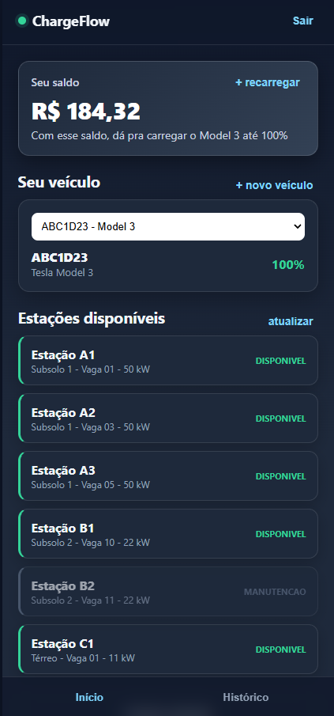 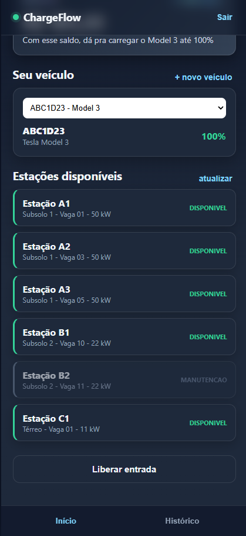

### Histórico

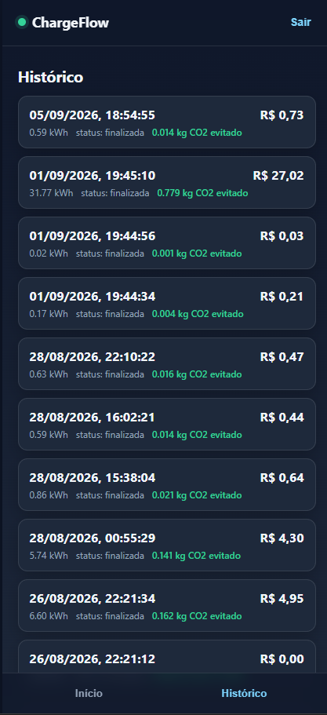

## Painel do administrador:

### Visão geral

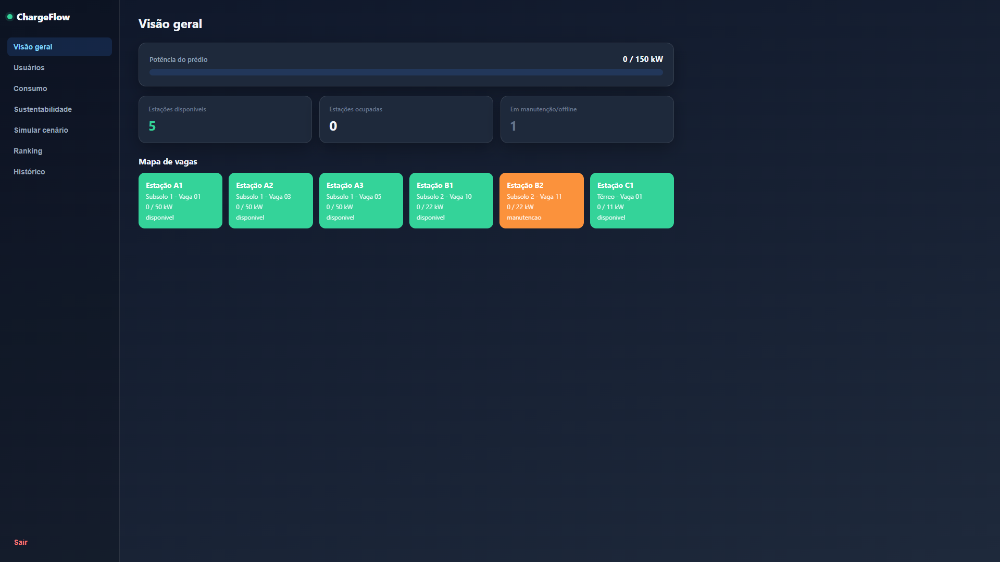

### Usuários

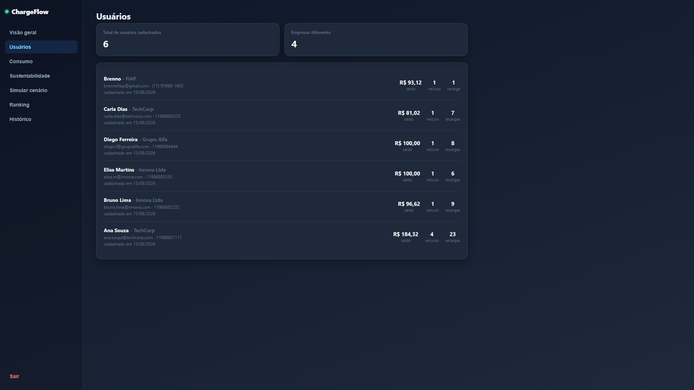

### Consumo diário

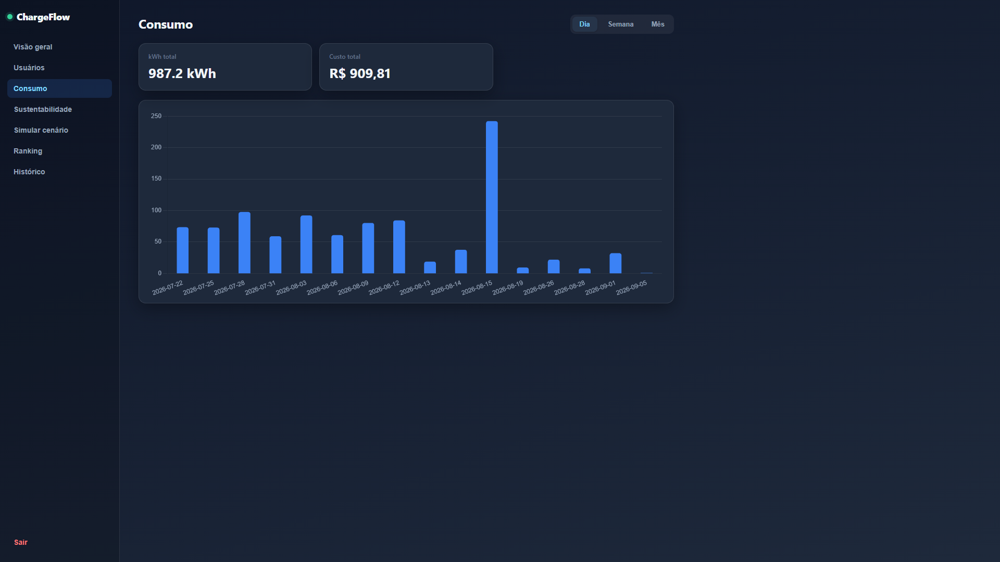

### Consumo semanal

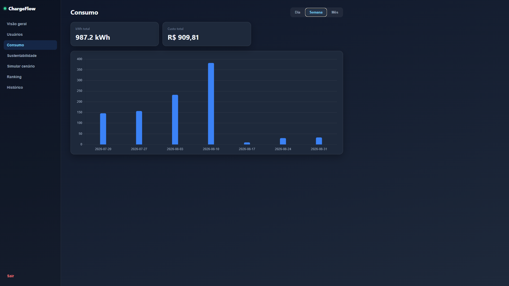

### Consumo mensal

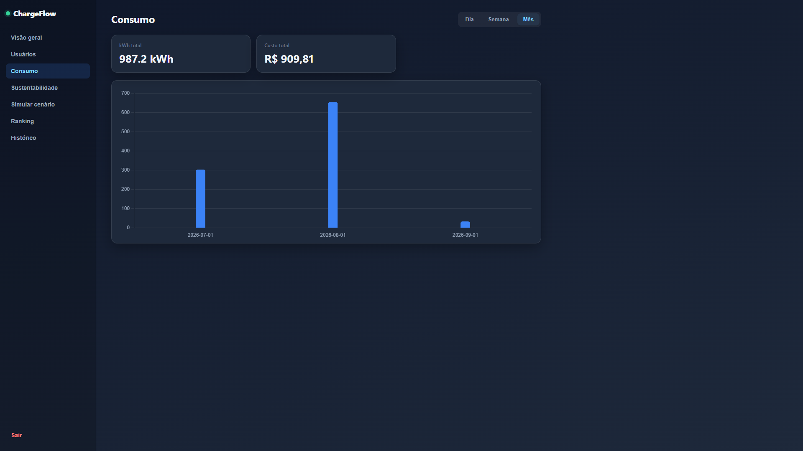

### Sustentabilidade

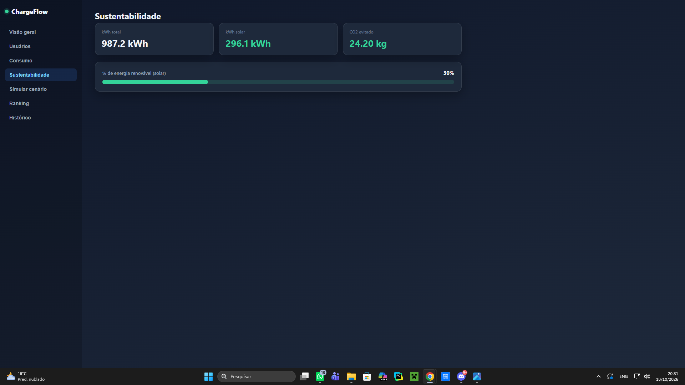

### Simulador

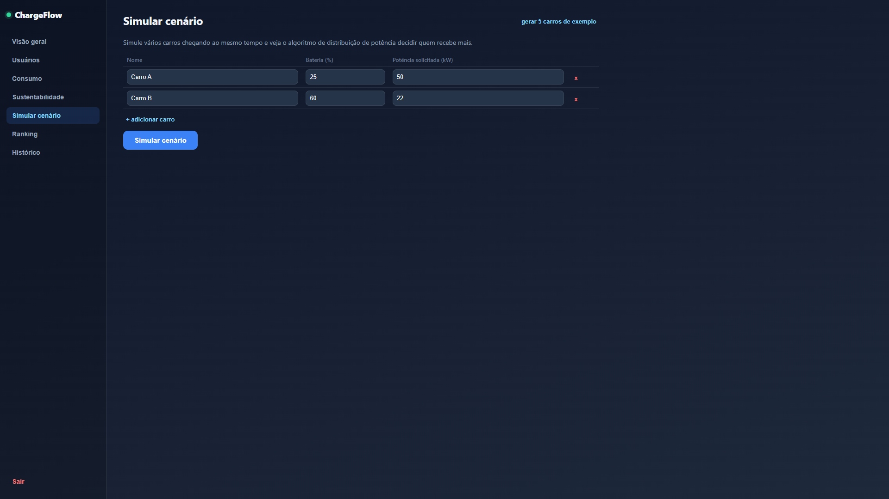

### Ranking

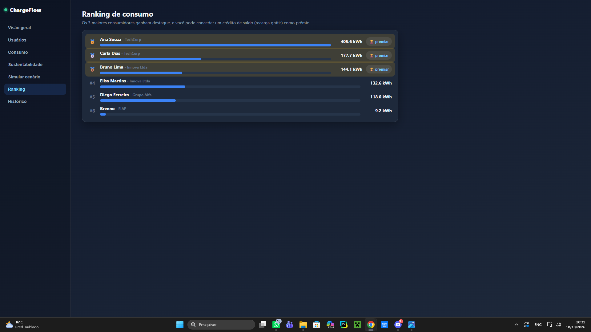

### Histórico 

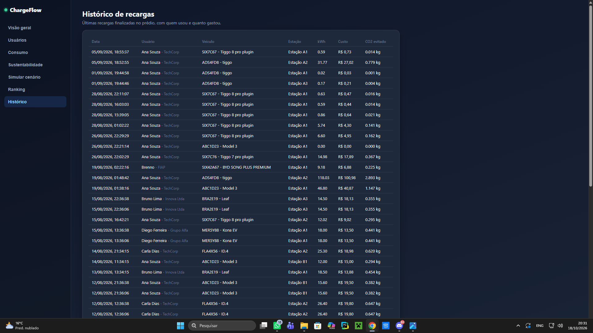


## 5. Alinhamento ao desafio GoodWe e à disciplina

O desafio pede geração, armazenamento e uso inteligente de energia renovável com monitoramento. O ChargeFlow cobre a ponta do **uso inteligente e do monitoramento**: controla a potência do prédio, prioriza quem mais precisa de carga, evita ultrapassar o limite contratado e mede quanto da energia consumida veio de fonte solar, convertendo isso em CO₂ evitado.

Quanto à tecnologia GoodWe, o sistema foi desenhado para receber a telemetria de um inversor híbrido e de uma bateria GoodWe (geração fotovoltaica, estado de carga e consumo do prédio) e usar esses dados como entrada do algoritmo, de modo que a potência liberada para os carros acompanhe a geração solar disponível. Nesta entrega, a geração solar entra no sistema como parâmetro de simulação (30% do consumo); a leitura em tempo real de um inversor e de uma bateria GoodWe é a evolução natural do projeto e o ponto de integração já está previsto na arquitetura.

Conexão com a disciplina: o projeto aplica priorização e distribuição de um recurso limitado (a potência do prédio) no simulador de cenários, modelagem de curvas de potência e cálculo de energia por integral definida, comunicação entre interface e servidor por meio de uma aplicação web, e visualização de dados nos gráficos de consumo, no ranking e no painel de sustentabilidade.

### Fundamentação matemática

A energia diária de um posto de recarga é a integral da sua curva de potência ao longo do dia, com P em kW e t em horas. Para o Posto 1, P1(t) = 5 + 20·sen(πt/24), com 0 ≤ t ≤ 24 h, a energia é E1 = 120 + 960/π ≈ 425,6 kWh/dia. Para o Posto 2, P2(t) = 16 + 15·cos(π(t − 20)/12), o termo cossenoidal integra zero em um período completo de 24 h, então E2 = 16 · 24 = 384 kWh/dia. O mesmo raciocínio vale para o ChargeFlow: o kWh de cada sessão de recarga é a integral da potência alocada ao longo do tempo em que o carro ficou conectado.

## 6. Avaliação crítica: sustentabilidade e inovação

Sustentabilidade: o painel mede 30% de energia solar no consumo e 24,20 kg de CO₂ evitado no período, e a distribuição inteligente de potência evita picos que forçariam o prédio a contratar mais demanda ou a recorrer à rede no horário mais caro e mais poluente. O sinal de "horário de pico" no app incentiva o motorista a deslocar a recarga.

Inovação: algoritmo de prioridade por nível de bateria, simulador de cenários para o administrador testar o comportamento antes de acontecer, cobrança pré-paga com parada automática, ranking de consumo por usuário e empresa com prêmios em crédito ou recarga grátis, histórico de recargas com CO₂ evitado por sessão, redução automática de potência em horário de pico e painel de sustentabilidade na mesma plataforma.

Limitações a declarar: o cenário de simulação gravado não leva o prédio ao limite de 150 kW; a origem dos dados de geração solar e de consumo precisa ser explicitada; o fator de emissão é único, e não varia por hora; e a integração com equipamento GoodWe real depende da etapa de hardware. Próximos passos naturais: usar a geração solar prevista para modular a potência liberada ao longo do dia, adotar protocolos abertos de carregadores (OCPP) e integrar um assistente virtual para consultar o status da recarga.

## 7. Tecnologias e referências

O frontend foi construído com JavaScript, HTML e CSS, a aplicação está hospedada na nuvem pelo Render (https://render.com) e o banco de dados é um PostgreSQL gerenciado na plataforma Neon (https://neon.tech), que guarda usuários, estações, saldos e o histórico de recargas. Os protocolos de recarga considerados na arquitetura são OCPP, OCPI e ISO 15118, que permitiriam conectar carregadores reais de diferentes fabricantes ao núcleo de gestão. Como referência de integração para geração e armazenamento, o projeto usa os equipamentos GoodWe, o inversor híbrido e a bateria (https://www.goodwe.com), cuja telemetria alimentaria o algoritmo de distribuição de potência. Os dados de sessões de recarga, consumo em kWh, custo em reais e CO₂ evitado são exibidos em gráficos de consumo, ranking e painel de sustentabilidade.

## 8. Estrutura do repositório

```
/
├── README.md
├── ChargeFlow/
│   └── ChargeFlow/
│       └── .gitignore
│       └── requiriments.txt
│       └── app/
│       └── frontend/
│       └── tools/
├── docs/
│   └── img/       capturas de tela do sistema funcionando
```
